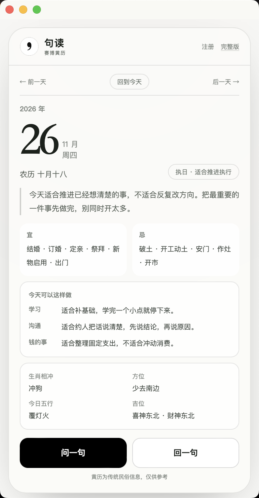

# 句读 JUDOU

> 不会回的消息，先读懂，再决定怎么说。

一个移动端优先的 Web 工具：把对方的话贴进来，先拆清楚 TA 在想什么，再给你方向；配一个常驻桌面的电子黄历小组件，可以就着当天排盘问问题、也可以看两个人的合盘。

<p>
  
  
  
</p>

---

## 功能

**提炼（一条消息 / 一整段话）**

- 一句话核心：30 字内说清这段到底在讲什么
- 2–4 条关键事实：压掉重复、抱怨和无效信息
- 真正的问题：这段里卡住的到底是什么
- TA 现在的温度：态度是冷、是犹豫、还是只是忙
- 还不确定什么：明确指出读不懂、需要补一句的地方
- 你现在可以做：1 句总方向 + 2–3 条具体动作（写动作，不写台词）
- 先别做什么：现在最不该踩的坑
- 认清对象：先判断这段在说谁——说你 / 说 TA 自己 / 说别人；你自己在讲整件事时也会切换口吻

**先知（排盘问答）**

- 只看自己 / 看看 TA 两种视角
- 问题预设：今天适合约 TA / 把话说开 / 开口道歉 / 谈钱
- 填生辰（日期 + 时间精确到分 + 出生城市 + 性别）才排盘，不填只按当天黄历答
- 真太阳时、四柱、十神、胎元、命宫、五行统计、纳音地势、大运
- 两边都填 → 合盘：日主五行生克 + 互补 + 相处建议
- 守边界：问「她有没有喜欢的人」这类别人的心思，直接说排盘看不出

**桌面小组件（macOS）**

- 常驻的小窗，默认就是完整黄历，可拖动、可缩放，宽度超过 620px 自动变左右两栏
- 底部两个入口：**先知**（排盘问答）、**回一句**（消息解读）
- 自带本地服务管理：端口探测 → 构建号校验 → 自动拉起 → 异常退出自动重启一次 → 退出即清理

---

## 架构

```
句读/
├── app/
│   ├── page.tsx                # 主工作台：回一句 / 先知
│   ├── widget/page.tsx         # 桌面小组件的黄历视图
│   ├── layout.tsx
│   └── api/
│       ├── summarize/route.ts  # 提炼核心（结构化 JSON）
│       ├── ask/route.ts        # 排盘问答（可带双人合盘）
│       ├── almanac/route.ts    # 当天/指定日期黄历
│       └── health/route.ts     # 健康检查
├── components/                 # MessageInput / SummaryCard / AskPanel ...
├── lib/
│   ├── askPrompt.ts            # 排盘问答提示词
│   ├── summarizePrompt.ts      # 提炼核心提示词
│   ├── chart.ts                # 四柱 / 真太阳时 / 大运 / 合盘
│   ├── places.ts               # 城市经度表
│   ├── knowledge.ts            # 沟通框架知识库
│   ├── summarizeDemo.ts        # 无模型时的提炼兜底
│   └── rateLimit.ts            # 单实例内存限流
├── desktop-widget/             # macOS Swift + WKWebView 桌面端
└── preview/                    # 界面截图
```

数据流：

```
输入 → /api/{summarize|ask}
     → buildPrompt（规则 + few-shot + 知识库 + 当天排盘）
     → OpenAI 兼容接口（或本地规则兜底）
     → 结构校验 / 字段归一
     → 结构化 JSON → 前端渲染
```

对象库、对话记忆、生辰都只存在浏览器 `localStorage`，不上传服务器。

---

## API

所有接口都是 `POST`（`/api/almanac`、`/api/health` 为 `GET`），返回 JSON，错误统一为 `{ "error": "..." }`。

### `POST /api/summarize`

```json
{ "text": "那一大段话…", "scene": "friend" }
```

返回：`subject` `core` `points[]` `meaning` `advice` `missing`。

### `POST /api/ask`

```json
{
  "question": "今天适合把话说开吗？",
  "focus": "partner",
  "birth": { "date": "2006-03-28", "hour": 10, "minute": 25, "place": "太原", "gender": "female" },
  "partnerBirth": { "date": "2005-10-19", "hour": 12, "minute": 30, "place": "太原", "gender": "male" }
}
```

返回：`answer` `basis[]` `caution`，填了生辰时附 `chart` / `partnerChart` / `synastry`。

### `GET /api/almanac?date=YYYY-MM-DD`

返回当天（或指定日期）黄历：宜忌、冲煞、五行、吉位、日值、生活建议。

### `GET /api/health`

```json
{ "ok": true, "build": "…", "time": "…", "model": "configured | public-fallback", "version": "1.0.0" }
```

限流：`summarize` 20 次 / 5 分钟 / IP，`ask` 30 次；超限返回 `429` + `Retry-After`。
多实例部署时把 `lib/rateLimit.ts` 换成 Redis 实现即可。

---

## 额度与自带 Key（BYOK）

- 默认是**公共模式**：不配 `OPENAI_API_KEY` 时，所有请求走 `PUBLIC_MODEL_URL` 的免费模型（有限流，够演示）
- 配上部署方 Key 后切到 **BYOK 模式**：每个浏览器 **5 次免费**（提炼 + 先知合计），计数存在本机 `localStorage`
- 免费请求走部署方的 `OPENAI_API_KEY`；用完之后页面会弹出「模型设置」
- 用户填自己的 Key 后，请求会带 `x-judou-key`（可选 `x-judou-base` / `x-judou-model`）头，服务端只用这一次、不落盘、不写日志
- 没有部署方 Key 也没有用户 Key 时，退回公共兜底模型（有限流，仅够试用）

> 5 次额度是前端计数，防君子不防小人；真要防刷，把计数换成 Upstash/KV 按 IP 计。

## 环境变量

| 变量 | 必填 | 说明 |
|---|---|---|
| `OPENAI_API_KEY` | 建议 | OpenAI 兼容接口的 Key；不填会退回公共模型（有限流，不稳定） |
| `OPENAI_BASE_URL` | 否 | 默认 `https://api.openai.com/v1`，支持任何兼容 `/chat/completions` 的服务 |
| `OPENAI_MODEL` | 否 | 默认 `gpt-4o-mini` |
| `PUBLIC_MODEL_URL` | 否 | 公共兜底模型地址，默认 `https://text.pollinations.ai/openai` |
| `PUBLIC_MODEL_NAME` | 否 | 公共兜底模型名，默认 `openai` |

服务端解析顺序：**请求头里的用户 Key → 部署方 `OPENAI_API_KEY` → 公共兜底**。

```bash
cp .env.example .env
# 填 OPENAI_API_KEY
```

> 公共兜底会把内容发到第三方，正式使用请务必配置自己的 Key。

---

## 本地运行

```bash
npm install
cp .env.example .env      # 填 OPENAI_API_KEY
npm run dev               # http://localhost:3000
```

生产构建：

```bash
npm run build
npm start
```

质量检查：

```bash
npm run typecheck   # 类型检查
npm run check       # 类型检查 + 生产构建
```

CI 在 `.github/workflows/ci.yml`：每次 push 跑 `npm ci → typecheck → build`。

---

## 桌面小组件（macOS）

```bash
npm install
npm run build                 # 先构建网页，桌面端启动更快
zsh desktop-widget/build-app.sh
open "desktop-widget/句读JUDOU.app"
```

或者双击 `启动句读JUDOU.command`（会自动装依赖、构建、生成 app）。

启动逻辑：

- 检查 `127.0.0.1:3211`、`4321` 上有没有可用的句读服务，并核对构建号，避免连到旧版本
- 都不通时自己在空闲端口拉起 `next start`；端口被占用会自动换下一个
- 同时只允许一个桌面实例，重复双击会把已有窗口调到前面
- 退出时结束自己拉起的服务，并用 PID 文件兜住上次异常退出留下的进程

运行时副本：macOS 会把「文稿」目录挡在隐私权限后面，后台子进程读不了。所以 `build-app.sh` 会把运行时同步到
`~/Library/Application Support/Judou/runtime`，桌面端只跑这份副本。改了代码后重新执行一次 `build-app.sh` 即可同步。

### 打不开怎么办

1. 点页面上的「重新连接」
2. 确认装了 Node.js：`node -v`
3. 看日志：`/tmp/judou-widget-4321.log`
4. 仍不行：系统设置 → 隐私与安全性 → 完全磁盘访问权限 → 添加「句读JUDOU」，然后重开

---

## 排盘说明

- 排盘必须有**出生年月日 + 出生时间（精确到分）+ 出生城市**；少一样都不算
- 引擎是 `lunar-javascript`（寿星天文历同源算法），本机计算：不联网、不需要 API Key、结果可复现
- 真太阳时 = 北京时间 + (经度 − 120) × 4 分钟 + 均时差；成都这类偏西城市能差一小时以上
- 合盘只看两边日主五行生克和互补，用来解释相处方式，**不预测「能不能在一起」**
- 所有命盘内容只作民俗参考，不构成任何决策依据

---

## 部署

**Vercel（推荐）**

1. 推到 GitHub
2. Vercel 导入仓库
3. 配置 `OPENAI_API_KEY`（建议同时配 `OPENAI_BASE_URL` / `OPENAI_MODEL`）
4. 部署

**自建**

```bash
npm ci && npm run build
OPENAI_API_KEY=sk-... npm start   # 默认 3000 端口
```

反向代理到 3000 端口即可；`/api/health` 可以直接接健康检查。

---

## Roadmap

- [x] 消息 / 长文提炼（核心、温度、下一步）
- [x] 桌面黄历小组件
- [x] 真太阳时排盘 + 合盘
- [ ] 账号体系与云端同步（目前全部是本机 localStorage）
- [ ] 浏览器插件：选中网页文字右键提炼
- [ ] 多语言

## License

MIT
